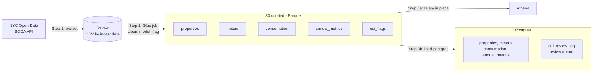
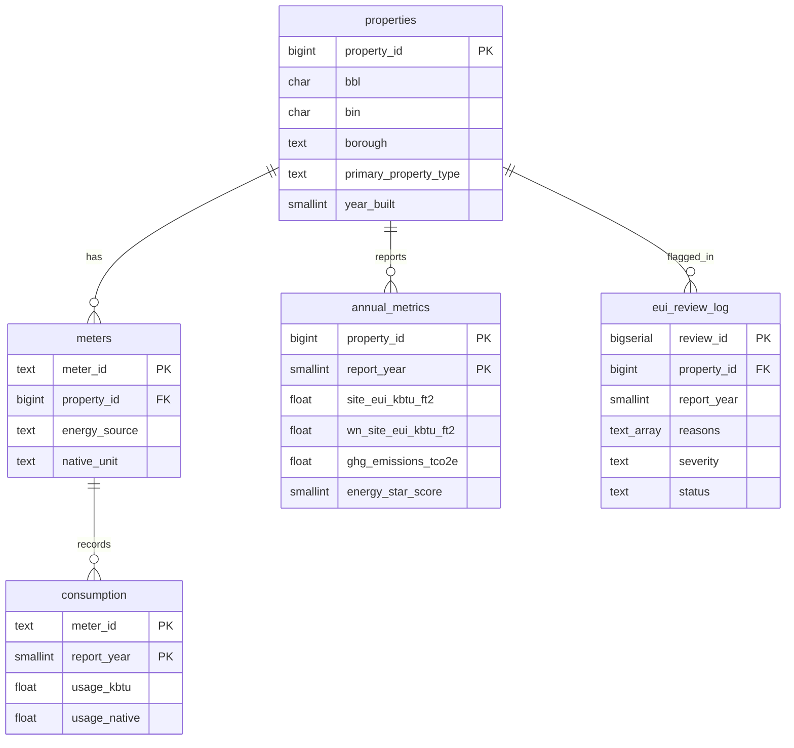

# NYC Building Energy Consumption Pipeline (LL84)

**AWS Glue · Athena · S3 · Postgres · Python (pandas)**

An end-to-end pipeline over New York City's public **Local Law 84** energy benchmarking
dataset (~30–39K buildings per year, 2022 onward). It lands the raw extract in S3, cleans
and models it with pandas inside an AWS Glue job, exposes partitioned Parquet to Athena for
cheap ad-hoc analysis, loads a normalized property / meter / consumption model into
Postgres, and flags buildings whose energy use intensity (EUI) moved outside the expected
range year over year, logging each one into a review queue.

- **Ingest:** paged download from the NYC Open Data SODA API (`5zyy-y8am`) → `s3://…/raw/ll84/ingest_date=YYYY-MM-DD/` (immutable history)
- **Transform:** Glue 5.0 job running the `ll84` pandas package → curated Parquet, partitioned by `report_year`
- **Model:** `properties`, `meters`, `consumption`, `annual_metrics`, `eui_review_log` in Postgres with idempotent COPY + upsert
- **Query:** Athena external tables with partition projection, a workgroup with a per-query scan cap, five saved analyses
- **Flag:** three independent rules (YoY % change, robust peer z-score, moved out of peer range), logged to file, S3 and Postgres

---

## Architecture



1. **Extract** downloads the dataset and stores the untouched CSV in `raw/`.
2. **The Glue job** cleans and models it, runs the year-over-year EUI flagging, and writes
   all five outputs, flags included, to `curated/`.
3. Two consumers read the same curated data:
   - **Athena** queries the Parquet files where they sit, for cheap ad-hoc analysis.
   - **`load-postgres`** copies them into Postgres in one step. The four model tables are
     upserted; `eui_flags` is merged into `eui_review_log` so reviewers' status and notes
     survive re-runs.

The Glue job's log output, including one line per flagged building, goes to CloudWatch for
monitoring only; it is not a data source for anything downstream.

The same transformation code runs locally (`python -m ll84 transform`) and in Glue, so you
can develop and test without an AWS account and deploy the identical logic.

## Data model



LL84 publishes annual totals per fuel, not individual utility meter IDs, so a **meter** is a
property's energy-source channel (`19466816-natural_gas`). Twelve sources are modeled:
grid electricity (kWh), natural gas (therms), district steam / hot water / chilled water,
fuel oils #1, #2, #4, #5&6, diesel, propane and kerosene (kBtu).

### Cleaning rules (`src/ll84/transform.py`)

| Problem in the raw data | Handling |
|---|---|
| Numbers delivered as text; missing values spelled `Not Available` | Sentinels → NULL, then numeric cast |
| Resubmissions: several rows for one property-year | Keep the latest `report_submission_date` |
| `Test` / `Design` properties | Dropped |
| Multi-lot BBL fields (`3035590001;3035740001`) | First valid 10-digit BBL kept, count stored in `bbl_count` |
| Placeholder BINs (`2999999`, `1000000`) | NULL |
| Missing or mis-spelled borough | Borough column, else derived from BBL's first digit |
| `year_built` of 1051 or 2088, coordinates outside NYC | NULL |
| Negative usage or floor area | NULL, counted in the quality report |

Each run logs a quality report (row counts, duplicates removed, % valid BBL, % with EUI).

### Year-over-year EUI flagging (`src/ll84/flagging.py`)

For each property reporting in two consecutive years, compare weather-normalized site EUI
when both years have it (otherwise site EUI, never mixing the two). A property-year is
flagged if any rule fires:

| Rule | Fires when | Default |
|---|---|---|
| `yoy_pct_change` | \|EUI change\| ≥ threshold | 50% |
| `peer_outlier` | robust z-score (median/MAD) of the log change vs same property type and year | \|z\| ≥ 3.5 |
| `moved_out_of_range` | EUI was inside its peer range last year and is outside it now (Q1 − k·IQR … Q3 + k·IQR) | k = 3 |

Peer rules only apply to groups of 20+ buildings. Severity is `high` when two rules fire or
EUI doubled / halved. Every flag is written to `logs/eui_flags.log`, to
`curated/eui_flags/` in S3 (queryable in Athena) and to `ll84.eui_review_log` in Postgres.
Re-runs refresh measurements without touching a reviewer's `status` or notes, and open
items that no longer trip any rule are auto-resolved with a note.

## Repository layout

```
├── src/ll84/
│   ├── extract.py          # SODA API paging, retries, landing raw files in S3
│   ├── transform.py        # cleaning + properties/meters/consumption/annual_metrics
│   ├── flagging.py         # YoY EUI anomaly rules
│   ├── load_postgres.py    # COPY + upsert, review-log merge
│   ├── athena.py           # DDL runner + saved queries
│   ├── storage.py          # same code for s3:// and local paths
│   ├── pipeline.py         # steps shared by CLI and Glue
│   ├── cli.py              # python -m ll84 <command>
│   ├── sample.py           # synthetic LL84-shaped data for offline runs/tests
│   └── sql/
│       ├── postgres/       # schema + reporting views
│       └── athena/         # external tables (ddl/) + analyses (queries/)
├── glue/ll84_transform_job.py   # Glue entry point
├── infra/                  # setup_aws.sh, deploy_glue.sh, teardown_aws.sh, IAM policies
├── tests/                  # unit tests + Postgres integration tests
├── docker-compose.yml      # local Postgres 16
├── Makefile
└── .github/workflows/ci.yml
```

---

## End-to-end setup

### 0. Prerequisites

- Python 3.11+ and `git`
- Docker Desktop (for local Postgres)
- An AWS account and the [AWS CLI v2](https://docs.aws.amazon.com/cli/latest/userguide/getting-started-install.html)
- A GitHub account; the [GitHub CLI](https://cli.github.com/) (`gh`) is optional but handy

### 1. Put the code on GitHub

```bash
cd nyc-ll84-energy-pipeline
git init -b main
git add .
git commit -m "Initial commit: NYC LL84 energy pipeline"

# Option A: GitHub CLI
gh auth login
gh repo create nyc-ll84-energy-pipeline --public --source=. --remote=origin --push

# Option B: create an empty repo at github.com/new (no README), then:
git remote add origin https://github.com/<you>/nyc-ll84-energy-pipeline.git
git push -u origin main
```

CI (lint + tests against a real Postgres) runs on every push from `.github/workflows/ci.yml`.

### 2. Local environment

```bash
python -m venv .venv
source .venv/bin/activate          # Windows: .venv\Scripts\activate
pip install -e ".[postgres,dev]"
cp .env.example .env
docker compose up -d               # Postgres on localhost:5432 (user/pass/db: ll84)
make test                          # unit tests; Postgres tests run when TEST_DATABASE_URL is set
```

### 3. Run it locally (no AWS)

Leave `S3_BUCKET` empty in `.env`; everything goes to `./data`.

```bash
python -m ll84 run-local --sample  # synthetic data: transform → flag → Postgres
python -m ll84 run-local           # the real dataset (~100K rows, a minute or two)
python -m ll84 review              # open review items, worst first
```

Optional: get a free Socrata app token and set `SOCRATA_APP_TOKEN` to avoid throttling.

### 4. AWS setup (once)

```bash
aws configure                      # access key for an IAM user with admin rights on this account
# in .env set: S3_BUCKET=ll84-energy-<yourname>-<random>  and AWS_REGION
bash infra/setup_aws.sh
```

This creates the bucket (public access blocked, encrypted, Athena results expire after 7
days), an IAM role for Glue scoped to that bucket, and the `ll84-wg` Athena workgroup with a
1 GB per-query scan cap.

### 5. Ingest into S3

```bash
python -m ll84 extract             # → s3://<bucket>/raw/ll84/ingest_date=<today>/ll84_raw.csv
```

### 6. Deploy and run the Glue job

```bash
bash infra/deploy_glue.sh          # builds the wheel, uploads it + job script, creates the job
python -m ll84 glue-run            # starts the job and waits (logs in CloudWatch)
```

Output: `s3://<bucket>/curated/ll84/{properties,meters,consumption,annual_metrics,eui_flags}/`.
Re-run `deploy_glue.sh` after any code change.

### 7. Athena

```bash
python -m ll84 athena-setup                 # database + 5 external tables
python -m ll84 athena-query list
python -m ll84 athena-query borough_eui_by_year --out reports/borough_eui_by_year.csv
make athena-queries                         # run all five, CSVs in reports/
```

Each run logs the MB scanned. Parquet + `report_year` partition projection keeps most
queries in the low-MB range; you can also paste any file from `src/ll84/sql/athena/queries/`
into the Athena console (replace `${DATABASE}` with `ll84`).

### 8. Load Postgres from the curated S3 data

```bash
python -m ll84 load-postgres       # reads s3://…/curated, upserts all tables + flags
python -m ll84 review
```

### 9. Review flagged buildings

```sql
SELECT * FROM ll84.v_open_eui_flags LIMIT 20;

UPDATE ll84.eui_review_log
   SET status = 'false_positive', reviewer = 'you', review_notes = 'Gut renovation in 2023'
 WHERE review_id = 42;
```

Statuses: `open`, `confirmed_issue`, `false_positive`, `resolved`. Tune sensitivity with
`YOY_PCT_THRESHOLD`, `PEER_Z_THRESHOLD`, `IQR_MULTIPLIER`, `MIN_PEER_GROUP` in `.env`
(re-run `deploy_glue.sh` so the Glue job picks them up).

### 10. Refresh and tear down

The city republishes LL84 annually. A refresh is `make run-aws`
(extract → Glue → Athena tables → Postgres → reports). When you are finished:

```bash
bash infra/teardown_aws.sh         # deletes bucket, job, catalog tables, role, workgroup
docker compose down -v
```

## Command reference

| Command | What it does |
|---|---|
| `python -m ll84 extract [--years 2023 2024]` | Download from NYC Open Data, land in raw zone |
| `python -m ll84 sample` | Synthetic LL84-shaped extract for offline work |
| `python -m ll84 transform [--no-flags]` | Raw → curated Parquet (+ flags), locally |
| `python -m ll84 flag` | Re-run flagging on curated data |
| `python -m ll84 glue-run` | Run the Glue job and wait |
| `python -m ll84 athena-setup` | Create Athena database + tables |
| `python -m ll84 athena-query <name> [--out f.csv]` | Run a saved analysis |
| `python -m ll84 db-init` | Create the Postgres schema |
| `python -m ll84 load-postgres` | Upsert curated data + flags into Postgres |
| `python -m ll84 review [--limit N]` | Print open review items |
| `python -m ll84 run-local [--sample]` | Extract/sample → transform → load |

## Troubleshooting

- **`AccessDenied` in Glue:** confirm the bucket in `.env` matches the one the role policy names; re-run `setup_aws.sh`.
- **Glue can't install the wheel:** jobs in a private VPC with no NAT can't reach PyPI; this job uses no VPC connection by default.
- **Athena `HIVE_BAD_DATA` / type errors:** re-run the Glue job and `athena-setup` after any change to curated column types.
- **Athena "query exhausted data scanned limit":** raise `ATHENA_SCAN_LIMIT_BYTES` in the workgroup, or add a `report_year` filter.
- **HTTP 429 from NYC Open Data:** set `SOCRATA_APP_TOKEN`.

## Notes and limitations

- Covers the 2022-present LL84 dataset (`5zyy-y8am`). Earlier years live in separate datasets with different column names; add a column-mapping step to backfill them.
- "Meters" are fuel channels per property because the public data does not expose utility meter IDs.
- `sample.py` data is synthetic and only for demos/tests; findings should come from the real extract.

## License

MIT
